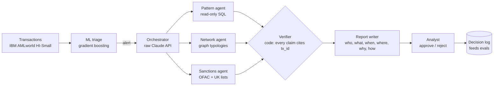

# Fraud Desk

**A multi-agent fraud and AML investigation desk, built in public in 60 days (2 Nov - 31 Dec 2026, posted every morning until 1 Jan 2027).**

An alert comes in. A machine-learning model decides whether it is worth a look. An orchestrator written
on the raw Claude API sends specialist agents to investigate in parallel: one reads the transaction
patterns in SQL, one walks the network of linked accounts looking for fan-in, fan-out and cycles, one
screens names against public sanctions lists. Every finding must cite the transactions it rests on, and
code (not another model) rejects any finding that does not. A report is drafted in the shape regulators
ask for. **A person approves or rejects every case.**

Then the honest part: the same cases are run three ways (ML only, one agent, many agents) and the repo
publishes recall, false positives, cost per case, latency, grounding and prompt-injection resistance for
each, including where the multi-agent version loses.

> Status: **Day 1 of 60.** Launched Tue 3 Nov. Follow along: one commit and one post a day (#60DaysOfAgents), and the [build log](#build-log) below.

## Why

Anthropic reports that a multi-agent research system beat a single agent by 90.2% on its internal
research eval, while using about 15x the tokens of a chat
([source](https://www.anthropic.com/engineering/multi-agent-research-system)). Fraud investigation is
parallel by nature (patterns, network, sanctions), so it should be a good fit. Whether the gain survives
a cost-per-case budget on labelled data is the question this repo answers in public.

## Architecture (target)



## Data

[IBM Transactions for Anti Money Laundering (AMLworld)](https://www.kaggle.com/datasets/ealtman2019/ibm-transactions-for-anti-money-laundering-aml),
the **HI-Small** set: 5M synthetic transactions, 515K accounts, about 5.1K laundering transactions, each
labelled, plus a patterns file naming the typology of each laundering attempt (Altman et al., NeurIPS 2023,
[arXiv:2306.16424](https://arxiv.org/abs/2306.16424)). Licence CDLA-Sharing 1.0: **the data is downloaded
by script and never committed here.** All data is synthetic; no real person or account appears.

## Run it

```bash
make setup          # uv venv + deps
make data           # Kaggle download (needs ~/.kaggle/kaggle.json)
make db             # CSV -> Parquet + DuckDB, every transaction gets a tx_id
make profile        # the numbers in today's post
make test           # offline, no API key, no dataset needed
```

## Plan

60 days in nine weeks: data and ML baseline, one agent, many agents, network and sanctions, verifier and
analyst UI, red-teaming, deploy, the three-way comparison, write-up. Day by day in
[docs/PLAN.md](docs/PLAN.md). What "better" means is fixed before any agent exists, in
[docs/EVALS.md](docs/EVALS.md). Every source this project leans on is in [docs/SOURCES.md](docs/SOURCES.md).

## Build log

One row per day, written the evening the work ships; the full notes are in [docs/LOG.md](docs/LOG.md).

| Day | Date | Title | Shipped | Link |
|---|---|---|---|---|
| 1 | 2 Nov | Foundation | Loader with stable `tx_id`, 4 offline tests, 60-day plan, eval spec, CI | [log](docs/LOG.md#day-1---foundation) |

## Rules this project keeps

1. **Evals before agents.** Metrics and the frozen case set are written down first.
2. **Grounding by code.** A finding without valid `tx_id`s is dropped by a deterministic check.
3. **Untrusted data stays data.** Transaction fields are never instructions (see [SECURITY.md](SECURITY.md)).
4. **A person decides.** Agents prepare; the analyst approves or rejects.
5. **Publish the losses.** If the multi-agent arm loses on cost or recall, that is the headline.

## 🤝 AI collaboration

Built with **Claude Code** as a pair. I choose what to build, review every change, run the evals and own
the result. Each daily post says so.

## Licence

Code: MIT. Data: not included; see its own licence (CDLA-Sharing 1.0).
