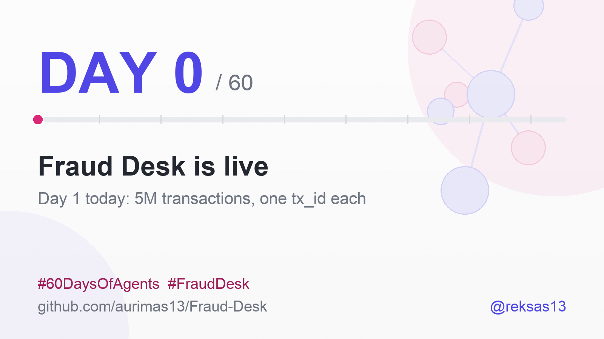

# Build log

One section per day: what shipped, one number, one lesson, what is next. Posted every morning as
#60DaysOfAgents on X, Bluesky, Threads and LinkedIn.

### Day 0 - Launch
Mon 2 Nov 2026

**Shipped:** repo scaffold, IBM AMLworld loader with stable `tx_id`s (4 offline tests), the 60-day plan, the eval spec, CI.  
**Number:** 60 days, one deliverable each ([PLAN.md](PLAN.md)).  
**Lesson:** write down what "better" means before any agent exists; the evals lock on Day 5.  
**Next:** Day 1 - download HI-Small, build Parquet + DuckDB, profile the data.

🤝 <b>AI collaboration:</b> built with Claude Code; reviewed and approved by me. See the <a href="../README.md#-ai-collaboration">note</a>.
